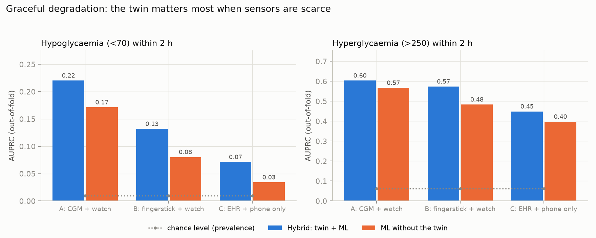
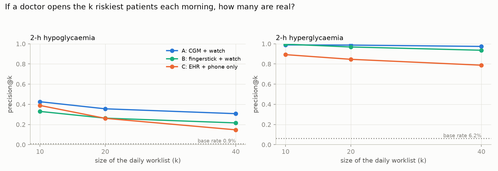

# UPVAAS-Twin: a festival-aware metabolic digital twin for Indians with type 2 diabetes

> **U**ncertainty-aware **P**hysiology-informed **V**irtual **A**vatar for **A**dverse-event **S**urveillance.
> *Upvaas* (उपवास) means "fast".
>
> It predicts hypoglycaemia and glucose spikes **2 hours ahead** by fusing a simulated EHR with wearable streams,
> and it lets a doctor **rehearse a patient's Navratri / Karva Chauth / Ramadan fast before the patient lives it**.
> It keeps working on fingersticks and phones, not only on CGMs.

Submission for the Happiest Health *Reimagining and Reforming Healthcare in India Summit 2026*, Digital Twin Challenge.

---

## 1. Submission details

| | |
|---|---|
| **Team name** | `<Team Name>` |
| **College / incubator** | `<College Name / Incubator>` |
| **Team leader** | `<Name>` · `<email>` · `<phone>` |
| **Members** | `<Name 1 (discipline)>`, `<Name 2>`, `<Name 3>` |
| **Project title** | UPVAAS-Twin: festival- and fasting-aware digital twin for predicting sulfonylurea-related hypoglycaemia and post-fast hyperglycaemia in Indian type 2 diabetes |
| **Video (≥20 min)** | `<unlisted YouTube link>` — shot list in [docs/VIDEO_SCRIPT.md](docs/VIDEO_SCRIPT.md) |
| **Presentation** | [docs/presentation.pdf](docs/presentation.pdf) (rebuild: `make presentation`) |
| **Architecture diagram** | [docs/architecture.pdf](docs/architecture.pdf) (rebuild: `make architecture`) |
| **Licence** | MIT — see [LICENSE](LICENSE). Generated synthetic data: CC0 1.0 |

> **Before submitting:** rename the repository folder to **`TeamName_CollegeName`**, fill in the four placeholder
> rows above, and paste the video link. Those are the brief's explicit requirements.

**Not a medical device.** A research prototype trained and evaluated only on synthetic data. It informs a
registered medical practitioner; it decides nothing.

---

## 2. Problem statement and healthcare use case

India has about **101 million adults with diabetes** and 136 million with prediabetes (ICMR-INDIAB,
*Lancet Diabetes Endocrinol* 2023). In a North-Indian T2D clinic cohort, **57% took a sulfonylurea** — a drug
class that keeps releasing insulin even when no food arrives — and **49% had fasted for religion in the past
year**. Only **4% checked their glucose during the fast** and **1.35% consulted a doctor first**
(Gupta et al., *touchENDOCRINOLOGY* 2020).

A morning glimepiride followed by a 13-hour nirjala fast is a **predictable** hypoglycaemia. The festive thali
that breaks the fast is a **predictable** spike. Today's digital twins see neither: they predict meal responses,
assume a CGM, and ignore the calendar.

**Chosen condition:** type 2 diabetes.
**Adverse events predicted 2 hours ahead:** hypoglycaemia (<70 mg/dL sustained ≥15 min) and hyperglycaemia
(>250 mg/dL sustained ≥15 min).
**The Indian twist:** sulfonylurea-treated patients during religious fasts — a dangerous state that is common,
unmonitored, and **scheduled**, and therefore predictable.

**Use case.** A diabetologist or Ayushman Arogya Mandir doctor sees every patient's 2-hour risk, understands
*why* (counterfactual drivers and the twin's mechanistic parameters), and can run a **Vrat Rehearsal** for
tomorrow's fast: usual dose vs moved to the fast-breaking meal vs halved vs low-GI foods. ASHAs get a ranked
**pre-festival recall list**. The same twin degrades gracefully from CGM to fingersticks to phone-only patients.

Full write-up: **[docs/SOLUTION.md](docs/SOLUTION.md)** · Research behind it: **[docs/research_report.md](docs/research_report.md)**

---

## 3. Results

<!-- RESULTS:START -->
**200 synthetic patients × 28 days · 5-fold patient-grouped cross-validation (every patient is scored by models that never saw them).** Every number below is regenerated from [`reports/metrics.json`](reports/metrics.json) by `python scripts/update_readme.py`, so the tables and the code cannot drift apart.

### How hard is this benchmark?

Accuracy figures mean nothing without this, so it comes first.

| | |
|---|---|
| Virtual body uses a **different model** from the twin | `True` |
| Correlation between the festival meal plan and what was **actually eaten** (2-h windows) | **0.55** |
| Share of real food intake that the calendar did **not** predict | **23%** |
| 4-feature baseline (planned carbs + HbA1c + time of day; no glucose, no twin) — hypoglycaemia AUPRC | 0.037 vs **0.220** for the full model |
| 4-feature baseline (planned carbs + HbA1c + time of day; no glucose, no twin) — hyperglycaemia AUPRC | 0.305 vs **0.603** for the full model |

> The body is integrated with `upvaas/physiology/truth_model.py`, which has a three-compartment gut, an interstitial insulin delay, circadian insulin sensitivity, renal glucose excretion and an incretin term. **The twin models none of these**, so the evaluation measures model misspecification and not just parameter error. Run `make ablations` to see what we would have scored without this.

### Main result — predicting an adverse event 2 hours ahead

**Hypoglycaemia (&lt;70 mg/dL for ≥15 min) within the next 2 h** · base rate 0.9% · 624 event onsets in 40 of 200 patients

| Sensor tier | AUROC | AUPRC <sub>[95% CI]</sub> | AUPRC without the twin | precision@20 | event recall | false alarms / patient-day |
|---|---|---|---|---|---|---|
| A · CGM + watch | 0.959 | 0.220 <sub>[0.10–0.34]</sub> | 0.171 | 0.36 | 56% | 1.00 |
| **B · 2 fingersticks/day + watch** | 0.911 | **0.132** <sub>[0.05–0.23]</sub> | 0.080 | 0.26 | 58% | 2.69 |
| C · EHR + phone only | 0.792 | 0.071 <sub>[0.02–0.14]</sub> | 0.034 | 0.26 | 62% | 6.87 |

**Hyperglycaemia (&gt;250 mg/dL for ≥15 min) within the next 2 h** · base rate 6.2% · 3901 event onsets in 196 of 200 patients

| Sensor tier | AUROC | AUPRC <sub>[95% CI]</sub> | AUPRC without the twin | precision@20 | event recall | false alarms / patient-day |
|---|---|---|---|---|---|---|
| A · CGM + watch | 0.942 | 0.603 <sub>[0.58–0.63]</sub> | 0.567 | 0.99 | 98% | 4.69 |
| **B · 2 fingersticks/day + watch** | 0.935 | **0.573** <sub>[0.54–0.60]</sub> | 0.483 | 0.97 | 95% | 4.95 |
| C · EHR + phone only | 0.913 | 0.448 <sub>[0.41–0.48]</sub> | 0.397 | 0.85 | 90% | 6.20 |

> **The headline is tier B, not tier A.** Without a CGM — which is where almost every Indian patient actually lives — the twin lifts hypoglycaemia AUPRC from 0.080 to **0.132** (1.6×) and cuts false alarms from 5.39 to **2.69** per patient-day. Of the 20 patients it flags each morning, about **5 really do have an event within two hours**, against a base rate of 0.9%.

### Ablations, including the ones that do not flatter us

| Ablation | AUPRC without it | Full model | Reading |
|---|---|---|---|
| Tier A (CGM), drop the twin | 0.171 | 0.220 | full model better (1.3×) — even against a dense CGM the mechanistic forecast adds signal a feature-based model misses |
| Tier B (fingersticks), drop the twin | 0.080 | 0.132 | full model better (1.6×) — two readings a day are too sparse to extrapolate from; the twin's physics fills the gap |
| Tier C (no glucose), drop the twin | 0.034 | 0.071 | full model better (2.1×) — with no glucose measurement at all, the twin's simulation is most of the signal there is |
| Tier A, drop the calendar features | 0.218 | 0.220 | **no real difference** — the calendar already reaches the model through the twin's planned inputs, so it is double-counted as a feature |
| Replace everything with a CGM trend rule | 0.099 | 0.220 | full model better (2.2×) — the obvious clinical heuristic, for scale |
| Hyperglycaemia: 4-feature timetable baseline | 0.305 | 0.603 | full model better (2.0×) — no glucose, no wearable, no twin - how much of this task is just knowing the meal schedule |

> Differences inside 5% relative are noise at these event counts and are labelled as such. The calendar's contribution **as model features** is one of them: its real value is in the Vrat Rehearsal, which runs days before any of these features exist.

### Forecasting and uncertainty (tier A)

| Horizon | Twin RMSE | Persistence RMSE | Clarke A+B |
|---|---|---|---|
| 30 min | **27 mg/dL** | 29 mg/dL | 98.9% |
| 60 min | **33 mg/dL** | 44 mg/dL | 97.9% |
| 120 min | **38 mg/dL** | 55 mg/dL | 97.2% |

A 90% band that is 90% *on average* can be far less than that exactly where a clinician is looking, so coverage is reported conditional on the outcome (120-min horizon):

| Method | Overall | When outcome &lt;70 | When outcome &gt;250 | Mean band width |
|---|---|---|---|---|
| Split conformal (one margin) | 0.90 | 0.95 | 0.47 | 125 mg/dL |
| **Mondrian (margin per glucose band)** | 0.90 | 0.91 | 0.58 | 110 mg/dL |

### Fairness — audited first on the axis this project is built on

| Fasting tradition | AUROC | n rows | events |
|---|---|---|---|
| karva_chauth | 0.980 | 20,559 | 76 |
| navratri | 0.938 | 122,551 | 1245 |
| none | 0.981 | 72,900 | 673 |
| ramadan | 0.973 | 39,164 | 404 |

Across sex, urban/rural, age, eGFR and region, hypoglycaemia AUROC ranges from **0.934** (region_west) to **0.991** (egfr_under_60).

### Vrat Rehearsal — reported with its caveat, not as a headline

Run the evening before a fast, the rehearsal ranks who will actually have a hypoglycaemic event the next day: **AUROC 0.77** over 143 fast days — but on only **11 events**, so the interval is very wide. Held-out halves: half_A: AUROC 0.80 (5 events) · half_B: AUROC 0.76 (6 events). It over-predicts (15% predicted vs 7.7% observed), which is the safe direction for a recall list but means the probabilities are not calibrated. **Treat as indicative, not validated.**

Across sulfonylurea-treated fasters, moving the dose to the fast-breaking meal lowers predicted hypoglycaemia from **28%** to **10%**.

### Twin self-check (drift) — a negative result

The normalised-innovation monitor detects illness days with AUROC only **0.53** (33% sensitivity at a 29% false-flag rate). We ship it as the hook a CDSCO Algorithm Change Protocol would attach to, and report it as **not yet good enough to deploy**.

*Full pipeline runtime: 101 min on a laptop CPU (`--quick` builds 60 patients in about 5).*
<!-- RESULTS:END -->




---

## 4. What is new

| # | Innovation | Why it matters | Where in code |
|---|---|---|---|
| 1 | **Festival-aware twin.** A calendar engine turns Navratri (phalahar / ek-samay), Ekadashi, Karva Chauth (nirjala), Ramadan (sehri/iftar), feasts and garba nights into the twin's *expected* meals, drug timing, sleep and activity | The twin forecasts the fast before it starts instead of treating it as noise | `upvaas/calendar_india.py` |
| 2 | **SU-Bergman-Gut model.** Bergman minimal model + gut absorption with GI-dependent kinetics + sulfonylurea PK/PD that **secretes insulin even at low glucose** + a **fasting clock** (hepatic output falls after ~11 h without food) + counter-regulation blunted by neuropathy | Explains *why* a fast plus a morning glimepiride is dangerous, so every prediction can be defended | `upvaas/physiology/model.py` |
| 3 | **Pharmacogenomic prior.** CYP2C9 genotype and eGFR lengthen the prior on sulfonylurea half-life; TCF7L2 lowers the prior on beta-cell gain; waist-to-height, TyG and ALT (not BMI) drive insulin sensitivity | Uses the brief's "genetic markers" mechanistically rather than as one more column, and fits the Indian thin-fat phenotype | `upvaas/twin/priors.py` |
| 4 | **Static sets the prior, dynamic updates the posterior.** A particle filter (64 candidate physiologies per patient) assimilates every glucose reading, including "unannounced-meal" particles for unlogged sweets | A real *twin* that follows the patient, not a one-shot classifier | `upvaas/twin/engine.py` |
| 5 | **Graceful-degradation ladder.** The same twin runs on tier A (CGM + watch), tier B (2 fingersticks/day + watch) and tier C (EHR + phone). Performance is published for each | Most Indians will never wear a CGM. This shows exactly what they lose and what the twin gives back | `scripts/run_pipeline.py` |
| 6 | **Vrat Rehearsal.** A 36-hour counterfactual replay on the posterior particles answers "if she fasts tomorrow and takes glimepiride as usual, what is P(hypo)? What if we move the dose, halve it, swap to low-GI, add a walk?" | Decision support *before* harm, with a human in the loop | `upvaas/twin/whatif.py` |
| 7 | **Trust layer.** Isotonic-calibrated risks, **Mondrian conformal** bands with coverage reported *conditional on the glucose range*, patient-clustered bootstrap CIs, counterfactual driver attribution, a twin self-check, and a fairness audit led by **fasting tradition** | Answers "can we trust it?" with measurements, including the ones that do not flatter us | `upvaas/twin/predictor.py` |

Two additions for the health system:

* **ASHA "Vrat Saathi" recall list** — before a festival every faster's twin rehearses the fast; patients are
  ranked by risk with ward, language and an action script, and escalated to eSanjeevani.
* **ABDM-ready FHIR R4 export** — Patient, Observation, MedicationStatement, RiskAssessment, and a Consent
  resource shaped like an ABDM consent artefact (purpose CAREMGT).

### How it differs from what exists

| | Twin Health / January AI | Academic hybrid twins | **UPVAAS-Twin** |
|---|---|---|---|
| Predicts | food → glucose response | glucose trajectories (mostly T1D) | **adverse events in T2D, 2 h ahead, plus what-if** |
| Model | gradient boosting / RF | physics-constrained neural net | **mechanistic ODE + particle filter + calibrated GBM** |
| Uncertainty | not published | sometimes, marginal only | **conformal, and reported conditional on glucose range** |
| Needs CGM? | yes | yes | **no — three sensor tiers evaluated** |
| Validated against | — | the same model family | **a structurally different body model** |
| India-specific | food database | no | **festival calendar, thin-fat prior, SU pharmacogenomics, PM2.5, ASHA workflow, ABDM FHIR** |
| Fairness audit | no | rarely | **yes, led by fasting tradition** |

---

## 5. Honesty notes

The fastest way to lose a technical jury is a number that cannot be broken. Four things are therefore built in
rather than bolted on, and all four are reported in `reports/metrics.json`.

1. **The virtual body does not run the twin's equations.** `upvaas/physiology/truth_model.py` has a
   three-compartment gut, an interstitial insulin delay, circadian insulin sensitivity, renal glucose excretion
   and an incretin term. **The twin models none of them.** So the evaluation measures model misspecification,
   not just parameter error. `make ablations` reports what we would have scored with a matched model.
2. **Eating is messy on purpose.** Wide meal-time jitter, large portion variability, skipped meals and genuinely
   unplanned snacks, so the festival calendar is a useful *prior* and not an oracle for future carbohydrate.
   The plan-vs-reality correlation is printed with every run.
3. **A trivial baseline is reported next to the headline.** Four features — planned carbs, HbA1c, time of day —
   with no glucose, no wearable and no twin. If that gets close to the full model, the benchmark is measuring a
   timetable, and the reader should know.
4. **Null results are in the README, not a footnote.** At tier A the twin does not improve hypoglycaemia
   precision, the calendar features do not help as features, and the drift monitor does not work well enough to
   deploy. All three are stated in §3.

Two more things are checked rather than asserted:

* **A leakage regression test.** `tests/test_core.py::test_no_feature_reads_future_truth` perturbs the future
  and asserts that **no** feature computed at the decision time changes, so an off-by-one window can never
  silently inflate these numbers. A companion test fails if anyone ever re-points the virtual body at the
  twin's own equations.
* **The cost of an easier benchmark is measured, not asserted.** `make ablations` re-runs the identical
  pipeline with the body on the twin's equations and with a predictable meal schedule, and
  `python scripts/compare_ablations.py` writes
  [`reports/BENCHMARK_ABLATIONS.md`](reports/BENCHMARK_ABLATIONS.md) showing exactly what we could have
  claimed instead.

**FHIR R4 export is validated, not just named.** `make fhir` parses every bundle in `data/fhir/` plus a freshly
generated one with the `fhir.resources` R4B schema; CI runs it on every push. Base-R4 validity is a necessary
step towards ABDM conformance, not a substitute for the NRCeS India profiles, and the script says so.

---

## 6. Technical stack

| Layer | What | Tech |
|---|---|---|
| Static data | India-localised synthetic EHR: 10 states, labs, meds, CYP2C9/TCF7L2/PRS, ABHA-format IDs, vrat questionnaire | Python, NumPy, pandas |
| Dynamic data | Minute-level body simulator → CGM (lag, noise, dropouts), fingersticks, HR, HRV, steps, sleep stages, meal & pill logs | NumPy (vectorised ODE) |
| Context | Festival & fasting calendar 2026–27, Indian food GI library, PM2.5 | JSON + Python |
| "Real body" | **SU-Bergman-Gut + 3-compartment gut, interstitial insulin delay, circadian SI, renal excretion, incretin** | `physiology/truth_model.py` |
| Twin core | **SU-Bergman-Gut** ODE: Bergman minimal model + gut absorption + sulfonylurea PK/PD + fasting clock + counter-regulation | `physiology/model.py` |
| Personalisation | EHR → physiology **prior** (ridge, pharmacogenomic), **particle filter** data assimilation (64 particles/patient) | NumPy |
| Prediction | HistGradientBoosting on fused EHR + stream + calendar + twin features, isotonic calibration, threshold for 80% recall | scikit-learn |
| Uncertainty | **Mondrian (class-conditional) cross-conformal** bands; patient-clustered bootstrap CIs | custom |
| Explainability | Counterfactual feature-group attribution; mechanistic parameters shown to the doctor | custom |
| What-if | 36-h counterfactual replay on posterior particles | NumPy |
| Interop | FHIR R4 bundles (Patient, Observation, MedicationStatement, RiskAssessment, ABDM-style Consent) | JSON |
| Serving & UI | REST API + clinician console | FastAPI/uvicorn (or stdlib fallback), vanilla JS, Plotly.js |

**Evaluation.** 5-fold **patient-grouped** cross-validation — every patient is scored by models that never saw
them, in the dashboard as well as in the metrics. Early stopping is deliberately **off**: scikit-learn's internal
`validation_fraction` splits rows at random, and with ~1,300 autocorrelated rows per patient that would choose
the iteration count on leaked data.

---

## 7. Quick start

Python 3.10+ (3.11/3.12 recommended), ~1.5 GB RAM, ~400 MB disk.

```bash
cd UPVAAS-Twin
bash run.sh              # venv, deps, full build, then opens the dashboard
# bash run.sh --quick    # 60-patient smoke build (~5 min)
```

Then open **http://localhost:8000**.

> **The full build takes roughly an hour and a half on a laptop CPU** (200 patients × 28 days × 3 sensor tiers × 5-fold CV
> × 3 ablations). Use `--quick` if you just want to see the dashboard. `run.sh` rebuilds only when the artefacts
> the dashboard needs are actually missing.

### Step by step (any OS, including Windows)

```bash
python -m venv .venv
# macOS/Linux: source .venv/bin/activate     Windows: .venv\Scripts\activate
pip install -r requirements.txt

python scripts/run_pipeline.py     # prior → cohort → simulate → twins → features → 5-fold CV → evaluate
python scripts/update_readme.py    # refresh the results tables in README / SOLUTION
python docs/make_architecture.py   # architecture.pdf / .png
python docs/make_presentation.py   # presentation.pdf
python serve.py                    # dashboard on http://localhost:8000 (Swagger at /docs)
python -m pytest -q tests          # unit + leakage regression tests
```

Or `make pipeline`, `make serve`, `make test`, `make presentation`, `make ablations`.

Set `OMP_NUM_THREADS=1` (as `run.sh` and the `Makefile` do) for bit-exact reproducibility; without it a few
metrics move in the 4th decimal through thread scheduling.

### The honesty ablations

```bash
make ablations                       # four benchmark settings, each writing its own metrics file
python scripts/compare_ablations.py  # -> reports/BENCHMARK_ABLATIONS.md
make fhir                            # validate the FHIR R4 bundles against the real schema
```

* `--matched-model` — integrate the body with the **twin's own** equations. Removes all misspecification and
  reproduces the optimistic setting most digital-twin papers report.
* `--easy-meals` — tight meal timing and almost no unplanned eating, so the calendar becomes a near-oracle.

Nothing about the twin changes between those runs — only how hard the test is. The comparison is written up in
[`reports/BENCHMARK_ABLATIONS.md`](reports/BENCHMARK_ABLATIONS.md).

### Run the twin on a real CGM file

```bash
python scripts/replay_cgm_csv.py     # runs on the bundled example and explains how to read the result
```

The twin is **not retrained**: the EHR sets the prior and the particle filter personalises it from the glucose
trace alone. On the bundled example, persistence wins at 30 min — glucose is strongly autocorrelated over that
span and "the same as now" is hard to beat — while the twin wins at 60 and 120 min, which is where something
has to be anticipated rather than repeated. Point it at a mapped ShanghaiT2DM or CGMacros file to do the same
on real data.

### What the pipeline writes

| Path | Content |
|---|---|
| `data/cohort/ehr.csv` | the synthetic EHRs (what the twin may see) |
| `data/cohort/hidden_truth_DO_NOT_USE_IN_TWIN.csv` | hidden physiology, used only to score the twin |
| `data/cohort/streams.npz`, `meals_log.csv` | 28 days of CGM/HR/HRV/steps/sleep/meals/meds |
| `data/fhir/*.json` | example FHIR R4 bundles |
| `artifacts/` | physiology prior, twin outputs, per-fold models, out-of-fold predictions |
| `reports/metrics.json` | every number in this README |
| `reports/figures/*.png` | degradation, ablation, benchmark difficulty, forecast, conformal coverage, precision@k, fairness |
| `reports/asha_pre_festival_recall_list.csv` | ranked ASHA list |

### Using the dashboard (doctor's view)

1. Pick a patient from the roster (ranked by 2-h risk). Chips show today's vrat type and any "recalibrate" flag.
2. Read the **risk cards** and their counterfactual drivers, then the **virtual patient** card (twin estimate vs EHR prior).
3. Drag the **time slider** or press ▶ to replay the days. Tick *reveal what actually happened* to check the forecast.
4. In **Vrat Rehearsal**, choose tomorrow's fast and a drug plan, then press *Rehearse*.
5. The **ASHA recall list** and **Model card** tabs show the population view and every metric.
6. *Export FHIR R4 bundle* downloads the ABDM-shaped record.

> Offline venue? Put `plotly.min.js` (v2.35.2) in `dashboard/vendor/` and the dashboard uses it when the CDN is unreachable.

### Run the twin on real (open) CGM data

```bash
python scripts/replay_cgm_csv.py --make-example                      # demo CSV from the synthetic cohort
python scripts/replay_cgm_csv.py my_patient.csv my_patient_ehr.json  # your mapped ShanghaiT2DM / CGMacros file
```

CSV columns: `timestamp, glucose_mgdl[, heart_rate, steps, carbs_g, su_dose_frac]`. See `upvaas/adapters.py`.
No real patient data are bundled, which is DPDP/HIPAA-safe by construction.

---

## 8. Repository structure

```
UPVAAS-Twin/
├── upvaas/                       core package
│   ├── config.py                 settings, thresholds, Indian priors (with sources), honesty switches
│   ├── calendar_india.py         festival & fasting calendar engine -> day plans
│   ├── foods.py                  Indian food GI library
│   ├── ehr/synth_ehr.py          Synthea-India-lite EHR generator (+ hidden physiology)
│   ├── physiology/model.py       SU-Bergman-Gut model  (what the TWIN believes)
│   ├── physiology/truth_model.py structurally different body model  (what actually HAPPENS)
│   ├── physiology/simulate.py    virtual body + CGM / watch / sleep / meal / pill streams
│   ├── twin/priors.py            EHR -> physiology prior (pharmacogenomic)
│   ├── twin/engine.py            particle-filter digital twin, forecasting, self-check
│   ├── twin/features.py          EHR + streams + calendar + twin fusion, 2-h labels
│   ├── twin/predictor.py         calibrated risk model, bootstrap CIs, precision@k, Mondrian conformal
│   ├── twin/whatif.py            Vrat Rehearsal counterfactual engine
│   ├── population/asha.py        pre-festival ASHA recall list
│   ├── interop/fhir.py           FHIR R4 / ABDM-shaped export
│   ├── adapters.py               run the twin on real CGM CSVs
│   └── service.py                API logic used by the servers
├── scripts/                      run_pipeline.py, make_figures.py, update_readme.py,
│                                 compare_ablations.py, validate_fhir.py, replay_cgm_csv.py
├── api/main.py                   FastAPI app
├── serve.py                      starts FastAPI, or the zero-dependency fallback
├── dashboard/                    clinician console (HTML/CSS/JS)
├── docs/                         SOLUTION.md, research_report.md, architecture.pdf, presentation.pdf
├── reports/                      metrics.json, BENCHMARK_ABLATIONS.md, figures, ASHA list (generated)
└── tests/                        unit tests + leakage regressions
```

---

## 9. Regulation and ethics by design

| Requirement | How UPVAAS meets it |
|---|---|
| **DPDP Act 2023 / Rules 2025** | Synthetic data only. Production design keeps a consent ID on every record, enforces purpose limitation (care management), deletes on consent expiry, logs breaches within 72 h. Training uses the research carve-out on anonymised data |
| **ABDM** | Registers as a Health Information User; consent artefact via HIE-CM; FHIR R4 bundles following the NRCeS IG (validate before production) |
| **CDSCO draft medical-device-software guidance (Oct 2025)** | Informs, does not drive, a registered practitioner → likely **Class B**. The drift monitor is the hook a pre-declared Algorithm Change Protocol would attach to — and we report that it is not yet good enough to serve as one |
| **ICMR 2023 AI ethics** | Human in the loop, Indian-representative priors, subgroup fairness audit led by fasting tradition, a model card, and a tier-C path that still works for patients who refuse or cannot afford wearables |

---

## 10. Deployment path

* **Where:** NP-NCD screening at Ayushman Arogya Mandirs (~25 million people on diabetes treatment under
  "75 by 25"), private diabetology clinics, CGM programmes.
* **How:** the ASHA app receives the ranked recall list two weeks before Navratri and Ramadan; the doctor runs a
  Vrat Rehearsal in clinic or over eSanjeevani; the patient gets a dose-timing plan in their own language.
* **Proof plan:** (1) retrospective validation on ShanghaiT2DM and CGMacros — the adapter is already written;
  (2) IRB-approved observational pilot at one centre during Navratri 2027, 100 SU-treated fasters on Libre CGMs;
  (3) cluster-randomised ASHA recall-list study with hypoglycaemia events and ER visits as outcomes.
* **Cost:** the twin runs on a laptop CPU; tiers B and C need no CGM. One clinic server can serve a district.

---

## 11. Key sources

ICMR-INDIAB (*Lancet Diabetes Endocrinol* 2023); ICMR-INDIAB diet study (*Nature Medicine* 2025); Gupta et al.,
dietary practices during religious fasts in T2D (*touchENDOCRINOLOGY* 2020); Holstein et al., CYP2C9 and
sulfonylurea hypoglycaemia (*Br J Clin Pharmacol* 2005, PMC1884896); thin-fat phenotype (*Frontiers in
Endocrinology* 2025); CARRS PM2.5 and incident diabetes (*BMJ Open Diab Res Care* 2023); Bergman minimal model;
Dalla Man et al. 2007 meal model; Vovk/Lei Mondrian conformal prediction; GlucoBench (ICLR 2024); PREDICT
sleep–glycaemia (*Diabetologia* 2022); JMIR Diabetes 2026 scoping review of diabetes digital twins; DPDP Rules
2025; NRCeS FHIR IG; CDSCO draft guidance on medical device software (Oct 2025); ICMR Ethical Guidelines for AI
in Healthcare (2023). Full report with links: [docs/research_report.md](docs/research_report.md).

---

## 12. Troubleshooting

* **`Artifacts missing` when starting `serve.py`** — run `python scripts/run_pipeline.py` first (or `bash run.sh`).
* **Port 8000 busy** — `python serve.py 8080`.
* **FastAPI not installed** — `serve.py` falls back to a standard-library server automatically; only Swagger is lost.
* **Slow machine** — `python scripts/run_pipeline.py --quick` (60 patients, ~5 min).
* **Numbers in the README don't match `metrics.json`** — run `python scripts/update_readme.py`.
